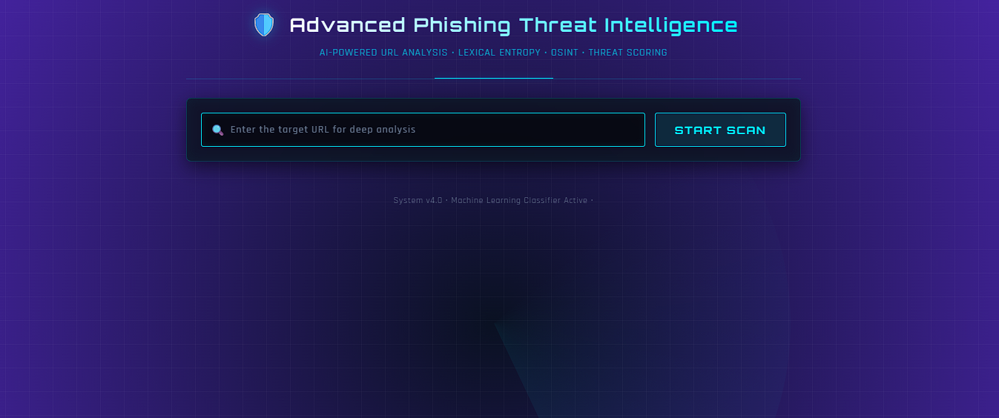
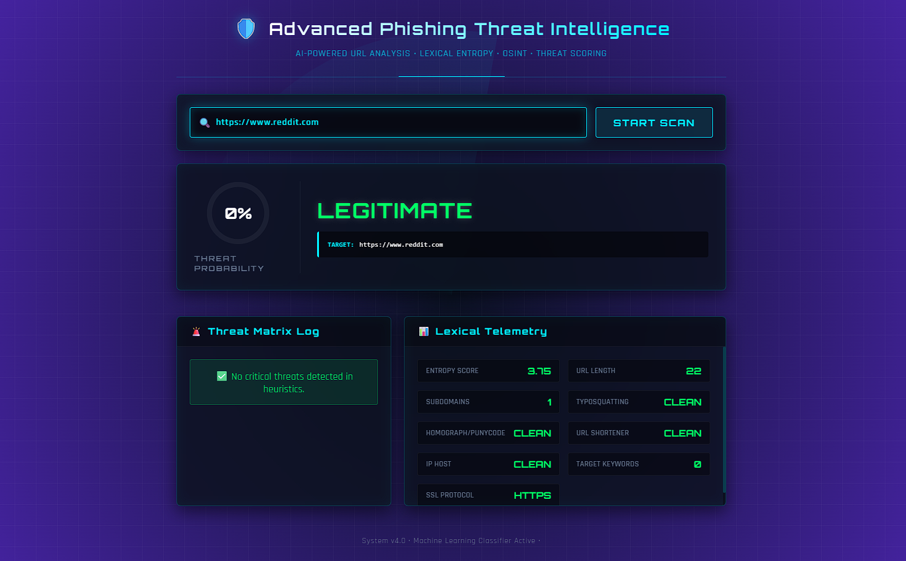

# Phishing URL Detection System

A machine-learning project that assesses whether a URL may be associated with phishing. It analyzes URL characteristics and presents a risk score and classification to support security awareness and defensive analysis.

**Live Demo:** https://url-detection-system-17od.onrender.com

> **Disclaimer:** This tool provides risk indicators, not definitive proof that a URL is safe or malicious. It is not a replacement for browser protections, threat-intelligence services, or human review.

## Homepage



## Detection Results




## Overview

Phishing URLs may imitate trusted services, use misleading domain names, or contain suspicious paths and keywords. This project uses URL-based feature extraction and a trained machine-learning model to classify submitted URLs as potentially legitimate or potentially phishing.

## How It Works

1. **URL Input:** The user submits a URL through the web interface.
2. **Feature Extraction:** The system analyzes characteristics such as URL length, subdomains, IP addresses, suspicious keywords, URL entropy, and possible typosquatting.
3. **Classification:** The extracted features are passed to the trained model to estimate the phishing risk.
4. **Results:** The interface displays the risk score, classification, and relevant detection reasons.

## Features

- URL-based phishing classification.
- Automated URL feature extraction.
- Detection signals for suspicious keywords and possible typosquatting.
- Risk score and classification results.
- Web interface built with Flask, HTML, CSS, and JavaScript.
- Model training and prediction utilities.

## Technologies Used

- Python 3.11.9 (to be specific, for smoother application running)
- Flask
- Scikit-learn
- Pandas and NumPy
- tldextract
- python-Levenshtein
- HTML5, CSS3, and JavaScript

## Installation

### 1. Clone the repository

```bash
 git clone https://github.com/harizonelopez/URL-Detection-System.git
 cd URL-Detection-System
```

### 2. Create a virtual environment

```bash
 python -m venv .env
```

### 3. Activate the environment

**Windows PowerShell:**

```powershell
 .env\Scripts\Activate
```

**macOS/Linux:**

```bash
 source .env/bin/activate
```

### 4. Install dependencies

```bash
 pip install -r requirements.txt
```

### 5. Run the application

```bash
 python app.py
```

Open the local address shown in the terminal, typically:
```text
 http://127.0.0.1:5000
```

## Example Input

Submit a URL such as:

```text
 https://example.com/account
```

You can also test unfamiliar domains and suspicious-looking URL patterns. Use controlled test cases when evaluating the system, and do not assume that an unfamiliar domain is malicious.

## Model Evaluation

Useful evaluation metrics include:

- **Precision:** How many URLs classified as phishing are actually phishing.
- **Recall:** How many phishing URLs in the test set are detected.
- **F1 Score:** A combined measure of precision and recall.
- **False-Positive Rate:** How often legitimate URLs are incorrectly flagged.
- **Confusion Matrix:** A summary of correct and incorrect predictions.

These metrics should be calculated using a representative, independently held-out test dataset.

## Project Structure

```text
    URL-Detection-System/
    ├── app.py
    ├── features.py
    ├── train_model.py
    ├── templates/
    │   └── index.html
    ├── static/
    │   ├── script.js
    |   ├── imgs/
    │   └── style.css
    ├── phishing_urls.csv
    ├── advanced_phishing_urls.csv
    ├── models.pkl
    ├── advanced_model.pkl
    ├── .python-version
    ├── requirements.txt
    └── README.md
```

## Limitations

- Model performance depends on the quality, diversity, and representativeness of the training data.
- Previously unseen phishing techniques may evade detection.
- Legitimate URLs may be flagged incorrectly, and malicious URLs may be missed.
- URL characteristics alone cannot establish whether a website is trustworthy.
- Domain registration, website content, redirects, and real-time threat intelligence are not necessarily verified by this system.

## Disclaimer

This project is intended for educational and defensive cybersecurity purposes. Predictions should be treated as risk indicators rather than definitive proof of a website's safety or maliciousness.
